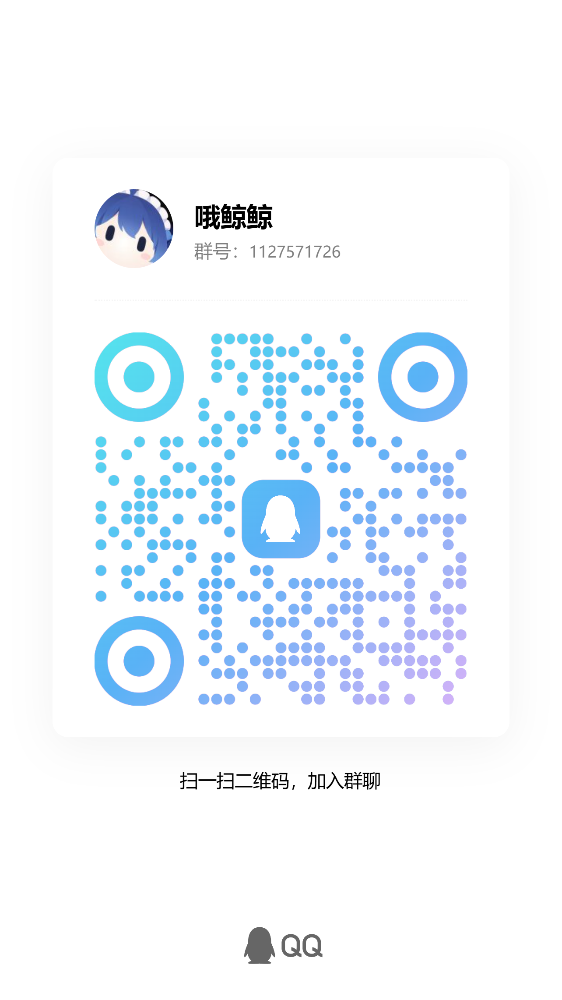

# WeChatAgent 0.3.2

Windows 微信助手与独立桌面控制台。支持白名单好友／群聊、人格预设、独立 DSH 会话、天气查询、网页正文阅读、图片理解、原生文字及表情包发送。内置功能可通过扩展页面管理。

## 安装使用

普通用户使用 GitHub Releases 附件中的 `WeChatAgent-Setup-0.3.2-x64.exe`。安装后通过“首次配置”登录自己的微信和 DSH、自动查找账号并连接验证数据库、选择聊天范围，日常操作无需命令行。首次白名单为空。安装器需由维护者上传至 Releases；本源码目录不包含它。

用户数据位于当前用户 AppData 下的 WeChatAgent 工作区。升级保留配置、人格编辑和私有状态；卸载保留用户数据。维护者的账号、密钥、联系人、聊天和运行日志未包含在源码中。

安装完成后，按“首次配置”依次连接微信账号、验证数据库、登录 DSH 并启用本项目插件、选择聊天范围，再启动助手服务。首次聊天范围为空，添加好友或群后保存并重启服务。

升级到 0.3.2 前，停止助手服务并从托盘完整退出助手和 DSH；安装后重新打开，确保加载新版界面与模型插件。账号、读取凭据、聊天范围、人格编辑及背景设置会保留。

## 版本与预设

- WeChatAgent：0.3.2；DSH 桌面端和插件 SDK 实际验收版本：`0.2.0-rc.2`。
- 匹配微信：Windows x64 `4.1.10.27`；版本可登录性需按实际账号和环境验证。
- 内置预设：傲娇助手、德克萨斯、洛奇希、示例助手、小鲸鱼。首次选中示例助手，可在桌面应用切换。
- 支持人格稳定复用、归档后创建新会话、图片完成后卸载输入、按聊天控制表情发送和标签缓存。
- 首次配置自动识别账号目录、获取并验证读取密钥，验证通过才安全保存；失败显示恢复步骤，保留原配置。
- 支持切换绑定账号：微信辅助进程不再误报为多客户端；读取凭据、聊天范围、消息状态与 DSH 会话按账号保存，切换后需完整重开 DSH。
- 支持人格 Markdown 导入、接收引用消息、按需联网搜索、逐聊天主动聊天与自动上下文压缩；联网及主动聊天默认关闭。
- 天气问题走 Open-Meteo 专用数据源，支持城市、当地日期和降水概率；没有城市时先询问。天气公共接口限个人及非商业使用，资料来源与条款见 LICENSES.md。
- 当前未提供主动拍回、文件发送、语音／视频理解或通用新版微信适配。

## 0.3.2 更新

- 修复桌面外链点击无响应，公开网页链接通过系统默认浏览器打开。
- 修复扩展卡片点击和状态显示，展示实际开启范围，保存后刷新，重新打开保留已保存的设置。
- 改进天气查询的城市与日期识别、城市补充及失败提示，过滤明显不相关的搜索摘要。
- 新增默认启用的网页阅读技能，以及统一管理内置功能的扩展入口。详细变化见 [发布说明](RELEASE_NOTES.md)。

## 使用内置功能

在“扩展”页管理网页阅读、自主表情素材搜索、联网搜索、原生表情发送、主动聊天和上下文压缩。点击卡片查看详情，修改开关或适用聊天后保存。列表显示已开启、已关闭、部分开启及开启范围；详情逐个显示聊天状态和待保存反馈。扩展页与回复设置共用配置，DSH 未连接时仍能查看已保存的开关，实际功能需在服务连接后按条件运行。

| 功能 | 如何使用 | 默认状态 |
| --- | --- | --- |
| 网页阅读 | 在允许的聊天中发送“总结这个网页：链接” | 开启 |
| 联网搜索与天气 | 开启联网搜索后询问，例如“上海明天天气怎么样” | 关闭；可为单个聊天覆盖 |
| 自主表情素材搜索 | 在扩展页授权联网和本地缓存、选择聊天，再发送“找个猫猫无语表情素材” | 关闭 |
| 原生表情发送 | 在允许的聊天中收到表情后，由模型按语境选择使用 | 开启；可为单个聊天覆盖 |
| 主动聊天 | 打开总开关，并逐个选择允许主动发送的聊天 | 关闭 |
| 自动上下文压缩 | 打开总开关，设置阈值和空闲等待时间 | 关闭；会话页另支持手动压缩 |

网页阅读支持本轮用户提供的公开 HTTP(S) HTML 或纯文本页面，支持 gzip、deflate 和 Brotli 压缩响应。可以发送“总结这个网页：www.bilibili.com”，也可以直接发送网址；`www.bilibili.com`、`bilibili.com`、`b23.tv/…` 等省略协议的网址会自动补全 HTTPS。每轮最多三页、每页最多 12,000 字符。不登录、不执行页面 JavaScript，也不会自动访问正文中的其他链接。取得的页面文字会交给当前模型处理；Bilibili 首页可读取实际返回的推荐条目，视频链接只读取页面文字，不代表观看视频或读取未显示的字幕。登录页、验证码、浏览器提示页、纯动态页面、PDF 等无法读取时会说明原因。

如果提示代理 DNS 返回 Fake-IP，请在代理客户端将 DNS 模式改为 `redir-host`，或在其 `fake-ip-filter` 中加入目标域名（Bilibili 可加入 `+.bilibili.com`、`b23.tv`），再重启代理和助手服务。这是代理客户端的配置，助手不会自动修改系统网络设置；内网地址保护仍然有效。

### 给机器人补充表情

1. 在“扩展 → 原生表情发送”或“聊天范围”中开启目标聊天的表情发送。
2. 在“回复设置”开启“学习并复用表情标签”；本机资源缺失时，可开启“允许从腾讯下载缺失的表情包”。
3. 助手运行后，由好友或群成员在这个允许的聊天中发送微信原生表情包。资源准备完成后，模型可在后续回复中选择使用。

目前公开版主要复用同一聊天最近收到的表情。普通图片不会自动加入可发送候选；表情库文件导入及搜图后自动下载入库尚未接入公开版。自主表情素材搜索返回链接，不会直接将新图片作为微信原生表情发送。本页管理已有内置功能，第三方技能导入也尚未在公开版开放。

### 自主表情素材搜索拓展

1. 打开“扩展 → 自主表情素材搜索”，开启“允许此扩展运行”。
2. 勾选“访问公开网络”和“保存当前聊天的数据”两项权限，选择允许使用的好友或群聊，然后保存。
3. 搜索来源建议保留 auto：先尝试 Bing 图片页面，失败后尝试 Openverse；也可选择单一来源。Imgflip 仅筛选热门模板。
4. 发送“找个猫猫无语表情素材”“找个熊猫鼓掌 GIF”。模型也可按人格和语境自主调用；每次最多三个候选，同聊天缓存减少重复查询和重复候选。

拓展默认关闭，与普通联网搜索开关分别控制。候选仅有素材链接和来源，尚未查看、下载或入库；不代表已经发送微信原生表情。启用后只查询简短情绪、动作或角色关键词。遇到网站验证、超时或 Fake-IP 时可能无结果，按提示处理；安装器不会修改系统或代理 DNS。第三方扩展导入仍未开放。

### 更新提示

安装本次 0.3.2 后，助手启动时通过 GitHub Releases 检查后续更新，也可点击侧栏“检查更新”。发现新版本或同版本的新构建时显示下载入口和发布说明；下载后停止服务、完整退出助手与 DSH，再运行安装包。网络失败时不会打断聊天。此前未内置更新检查的版本，需要先手动安装本次更新。

## 源码与构建

运行要求：Windows 10/11 x64、Node.js 22.13+（建议 24）、Python 3.10+ 及读取依赖。桌面构建依赖在根 package.json 固定版本。

```powershell
npm ci
npm ci --prefix packages/dsh-social-bridge-plugin
python -m pip install -r scripts/reader-requirements.txt
npm run desktop:build
```

构建完成后双击根目录 WeChatAgent.exe 或 WeChatAgent-Console.vbs。源码副本不包含微信、DSH、第三方 Hook、已编译原生库或任何运行环境，完整收发需独立准备相应组件。外部组件说明见 [发送后端](docs/WECHAT_HOOK.md)。源码模式的自动连接需另行准备已授权的 wx_key.dll，放到 components/weflow-cli/resources/key/win32/x64/；安装器会内置该组件，普通用户无需手动准备。

安装器构建需要已获授权的微信客户端、Hook 编译产物及 DSH 程序。准备到本机私有 state/hook 目录，设置 DSH 程序目录后构建；每次均校验 DSH 与 SDK 版本匹配，并按根 package.json 中的版本号生成安装器。

```powershell
$env:WECHATAGENT_DSH_SOURCE = '<DSH program directory>'
npm run desktop:build
npm run installer:runtime
npm run installer:build
```

## 检查

```powershell
npm run privacy:check
```

公开副本不附带开发回归测试、合成数据生成器或独立模型验证脚本。开发探针测试入口也已移除；应用内的环境检查、数据库读取检查和实际发送后端检查仍保留。部署、启动与日常收发不依赖测试源码。

## 目录

| 目录 | 用途 |
| --- | --- |
| apps/console-desktop、public/console | 桌面程序与界面 |
| scripts | 生命周期、读取 API、构建与原生覆盖层 |
| packages/dsh-social-bridge-plugin | DSH 0.2 插件及依赖锁 |
| components/qq-bridge | MIT 微信社交运行源码子集 |
| components/weflow-cli | MIT 数据库读取源码子集 |
| roles | 五份预设与说明 |
| config/wechatagent.example.json | 空白聊天范围的示例配置 |

## 数据与许可

启用云端模型后，选中的聊天消息、人格、图片，以及按请求取得的网页正文会交给配置的模型服务；本机读取不代表模型推理发生在本机。聊天不能修改人格、白名单、规则或模型工具权限，配置仅由本机所有者管理。

原作者署名和各组件许可保留，见 [LICENSES.md](LICENSES.md) 与 [components.json](components.json)。维护者已确认当前使用组件的再分发授权；这不将第三方程序、代码或角色素材重新许可为 MIT，也不表示微信或 DeepSeek 的官方背书。

源码与安装器分开发布：仓库提交本目录源码，Releases 附加安装器、SHA256SUMS.txt 和验证记录。推送与发布命令见 [GitHub 发布步骤](docs/GITHUB_PUBLISHING.md)。安装、启动、升级及卸载验收使用维护者 Windows 11 的隔离目录，不替代其他电脑或账号的实际登录与收发验证。

## 免责声明

本项目仅供学习、技术交流与个人实验使用。请在合法授权的前提下使用，并遵守适用法律法规、平台规则及第三方组件的许可要求。请勿用于骚扰、诈骗、未经授权的数据访问，或其他侵害他人权益的行为。

本项目为第三方技术整合，不代表微信、腾讯或 DeepSeek 官方，也不构成任何官方合作或背书。项目按现状提供，不保证所有客户端版本、账号和运行环境均可正常使用。使用前请做好必要的数据备份，并自行评估账号、隐私及模型服务使用等风险。“仅供学习”的说明不替代相关许可或授权。

## 自定义背景

点击右上角“换肤”，选择自己的 PNG 或 JPG 图片（最大 20 MB），可实时调整背景显示强度或恢复默认。浅色、深色主题均保留阅读遮罩。图片保存在本机 state/desktop 下，重启后继续生效，不上传至模型，也不作为公开源码或安装包预设分发。


## 交流与反馈

使用过程中遇到问题，欢迎添加 QQ群 交流反馈。没有问题也欢迎扩列，聊聊技术或日常。



## tips
默认人格的攻击力为**3250**，特别会怼人
